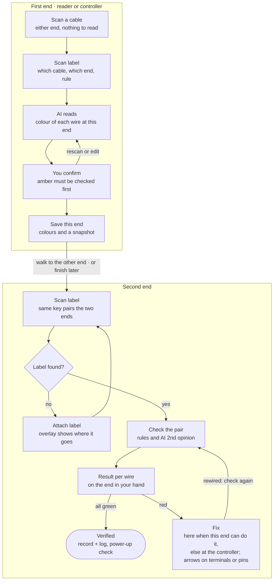
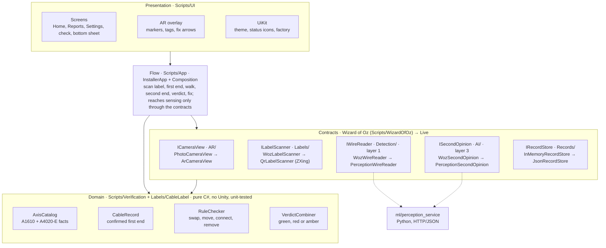

# Installer Assistant – MVP Blueprint & Design Rationale

Yu (package A) · first written 17 Oct 2026, updated 18 Oct 2026. Source for the course report: every design decision here has a reason the report can cite. Change it through a pull request like any other file.

The MVP verifies one cable end to end: an AXIS A4020-E reader wired to port READER 1 of an AXIS A1610 door controller. In live mode it checks **any wiring** of that cable, as the installer actually made it: the first end's record and the A1610 pin table define what is correct, not a list of known faults, so every swap, move, missing or extra wire is found and its fix shown where the installer's hands are. The Wizard-of-Oz mode demonstrates how the product looks and feels with two planted faults; it is the blueprint for the interaction and the study's fallback, not the limit of the product. Its flow, screens, wiring rules, fix logic and verdicts are the app's real code; only the sensing services (camera view, label scanner, wire reader, second opinion) are scripted, and only in that mode.

## Goal and research question

Installers wire field devices to the A1610 and leave. Wiring mistakes surface later, as a reader that never comes online. The Installer Assistant is an Android AR app for **checking finished wiring before the installer leaves**, rather than guiding each step. This angle is less studied than AR guidance, which earlier work showed reduces errors in assembly and maintenance (Tang et al., 2003; Henderson & Feiner, 2011).

**Research question.** Does in-situ AR verification help installers find wiring errors more reliably than the paper checklist and wiring table?

**What the study measures:** planted faults found, time to a verified installation, how often the installer overrides the automation (and whether rightly), SUS and NASA-TLX. [Evaluation hooks](#evaluation-hooks) lists the events the app already logs for this.

## MVP scope

The MVP is the smallest product that can answer the research question on the lent kit (Ries, 2011): one usage and one cable, any wiring of it, every step of the check.

| Area | In the MVP | Later |
| --- | --- | --- |
| Usage | OSDP reader on port READER 1, controller-powered | Port READER 2, Wiegand readers, door monitor (Door 1, IO5/IO6), lock relays |
| Faults found (live) | Any difference between the two ends: swaps, moves, rotations, missing, extra or wrong-pin wires; unclear pins go amber | Faults the camera cannot see (a loose screw, a broken core) |
| Cable identity | Label scanned at both ends; check blocked without it | App-generated labels |
| Reader end | AI reads 4 terminals; installer confirms, edits or rescans | — |
| Controller end | All 8 pins of Reader 1 read; rules + independent AI second opinion | Several blocks in one view |
| Feedback | Green / red with fix / amber "check this", AR fix arrows, linked snapshot | Voice, glove-friendly gestures |
| Record | Session log (CSV) and both snapshots | Report export to the customer's system |
| Device status | Physical symptom named in the fix card | Reading reader status from the A1610 |

**Demonstration faults (Wizard of Oz and study tasks)**

The live check does not depend on these; they are the scenarios the Wizard-of-Oz mode stages, chosen from the Axis documents because each one shows a different part of the check.

1. **RS485 A and B swapped.** Green and yellow sit on each other's pin. The A4020-E wiring table requires reader A to controller A and reader B to controller B. A swapped pair cannot communicate, so the reader keeps flashing red ("waiting for controller connection"). It shows as two wrong colours on adjacent pins. Real photos exist.
2. **Data wire on the wrong B pin.** Yellow sits on pin 6 (`B / O2`) instead of pin 4 (`B / D1`). The A1610 board prints A and B twice, but OSDP uses half-duplex RS485 on pins 3–4 only; pins 5–6 are for full-duplex TX or Wiegand outputs. This is a trap the board itself sets, and it tests the move-to-pin fix and the "pin must stay empty" rule.

A missing label at the controller end is planted in case 1 as a process fault. One AI disagreement on a correct pin is planted to exercise the amber path. Both faults can be staged on the lent kit without power.

## Grounding in the Axis documents

Every pin name, pairing and symptom the app shows comes from the Axis manuals and was checked against the team's photos of the lent kit. In code it lives in one place, `Verification/AxisCatalog.cs`, so a rule is fixed once.

**AXIS A1610, Reader 1 block (blue, 8 pins)**

| Pin | Printed on plug | Silkscreen | Function (A1610 manual, Reader connector) | OSDP reader |
| --- | --- | --- | --- | --- |
| 1 | − | − | DC ground (0 V) | Reader − |
| 2 | 12V | +12V | +12 V DC out; 500 mA shared by all readers | Reader + |
| 3 | A | A / D0 | RS485 RX/TX, half duplex (Wiegand D0) | Reader A |
| 4 | B | B / D1 | RS485 RX/TX, half duplex (Wiegand D1) | Reader B |
| 5 | O1 | A / O1 | RS485 TX, full duplex only (Wiegand open-drain output) | must be empty |
| 6 | O2 | B / O2 | RS485 TX, full duplex only (Wiegand open-drain output) | must be empty |
| 7 | IO7 | IO7 | Configurable input/output | must be empty |
| 8 | IO8 | IO8 | Configurable input/output | must be empty |

Reader 2 is the green block with the same layout (O3, O4, IO9, IO10). The protocol is chosen per port in the A1610's web page.

**AXIS A4020-E reader**

- Terminals `− + A B`. The A4020-E wiring table pairs `+ → 12 V`, `− → −`, `A → A`, `B → B` for Axis door controllers other than the A1001, where A and B cross. The pairing therefore belongs to the controller model, which is why the app looks it up instead of assuming it.
- LED stripe flashing red = "Waiting for controller connection". The app uses this as the visible symptom of a data fault, and as the check after power-up.
- DIP switches 1–2 set the OSDP address (both off = 0, the default); switch 3 sets RS485 termination.
- Model identified from the 6-position DIP switch and `− + A B` terminals in the team's photos; to be confirmed with Axis.

Sources: [AXIS A1610 user manual](https://help.axis.com/en-us/axis-a1610), [AXIS A4020-E user manual](https://help.axis.com/en-us/axis-a4020-e), [AXIS A1610 datasheet](https://www.axis.com/dam/public/81/33/47/datasheet-axis-a1610-network-door-controller-en-US-386201.pdf).

## Verification flow

The installer starts at whichever end is in front of them. The label says which cable it is and which end (DEV or CTRL), so the app records that end, names where the other end is, and pairs the two scans by the cable key. The first-end record, not a colour convention, defines what the other end must look like, whichever end was scanned first.

The check cannot start without the label, because the label is the only thing that links the two ends of one cable. The verdict appears on the end in hand. Fixes are shown where the installer stands whenever that end can do them: wire colours carry no meaning of their own (assumption 7), so a swap among the cable's own wires is fixed at either end. Only a fix that needs the controller (a wire on a pin the rule does not use, an extra wire or a loose wire) sends the installer back, and then every fix is listed there, in one place. Every red pin loops back to a recheck after re-wiring. Amber pins are decided by the installer in the fix card, against the linked snapshot of the other end.

## Architecture

The app is layered so that going live means replacing the classes behind four contracts, not rewriting the app. Dependencies point inwards to a domain that knows nothing about Unity, AR or AI (the dependency rule; Martin, 2017). Each sensing step sits behind an interface with a scripted and a real implementation, chosen at start-up by `App/Composition.cs`; this is the Strategy pattern (Gamma et al., 1994).

**Nothing scripted in live mode.** Live mode holds no planted faults, no expected colours and no pin positions in code. Wiring rules come from the manuals, kept in one place (`AxisCatalog`); where each terminal sits comes from a template per connector (one reference photo with its pins marked); colour references and the confidence temperature come from data files fitted on bench photos. Supporting a new connector or a new cable colour therefore means adding data, not changing code. The test readers (`dummy`) answer the same for every photo and exist only to test the plumbing; the service starts with the real reader unless one is chosen explicitly.

The flow also calls the domain directly: it builds the record, runs the rule check and combines verdicts. The `App` folder never references `WizardOfOz`; the Wizard of Oz plugs in through `IServiceSource` (`WizardOfOzRig` on the same GameObject).

| Part | Folder | Responsibility | Status |
| --- | --- | --- | --- |
| `AxisCatalog` | `Verification/` | Pins, pairings, symptoms and sources from the manuals; one `UsageRule` per label usage | Real |
| `CableRecord`, readings | `Verification/` | Confirmed first-end colours; expected colour per controller pin | Real |
| `RuleChecker` | `Verification/` | Differences → swap / move / connect / remove, with why, symptom and whether the device end can do it | Real, tested |
| `VerdictCombiner` | `Verification/` | Rules × second opinion × confidence → green / red / amber | Real, tested |
| `CableLabel`, `ILabelScanner` | `Labels/` | Parses `IA\|D1\|READER\|C01\|DEV`; finds the label | Parser real; `QrLabelScanner` stub (ZXing, untested) |
| `ICameraView` | `AR/` | Camera image, frames for the readers, anchors per terminal, end snapshots | Photos in WoZ; `ArCameraView` webcam stub, AR Foundation next |
| `IWireReader` | `Detection/` | Colour per terminal with confidence and image position (layer 1) | Scripted; `PerceptionWireReader` → Python service |
| `ISecondOpinion` | `AI/` | Independent match / mismatch per pin (layer 3) | Scripted; `PerceptionSecondOpinion` → Python service |
| `IRecordStore`, `SessionLog` | `Records/` | Keeps both ends per cable key; CSV event log | In memory (WoZ); `JsonRecordStore` (live) |
| `UiKit`, `ArOverlay` | `UI/` | Theme, markers, non-overlapping tags, fix arrows | Real |
| `InstallerApp`, `Composition` | `App/` | Flow and screens; picks the implementation behind each contract | Real |
| `WizardOfOzRig`, `DemoLayout`, `WozServices`, `PhotoCameraView` | `WizardOfOz/`, `Config/` | Photos, pin positions, planted faults, operator keys | Wizard of Oz only |

**Replacing the Wizard of Oz**, in roadmap order (packages in brackets; details in `docs/packages/`):

1. `ICameraView` → `ArCameraView` on AR Foundation/ARCore, handing each CPU image to the readers as a `CameraFrame` (B).
2. `ILabelScanner` → `QrLabelScanner`, QR decoding of the camera frame with ZXing.Net (A).
3. Terminal positions → returned by the wire reader as image points (feature matching to a reference photo of the board), then anchored in the world by the camera view, so markers stay on the terminals while the phone moves (A, B).
4. `IWireReader` → `PerceptionWireReader`: crops beside each terminal read by the perception service (classical CIELAB colour, then a VLM on the crops), with calibrated confidence (A).
5. `ISecondOpinion` → `PerceptionSecondOpinion`: a separate call with both ends' crops and the pairing rule, never the rule check's answer (A).
6. `IRecordStore` → `JsonRecordStore`, records that survive an app restart (C).

The flow, the screens and the domain stay as they are.

## Verification logic

The AI only perceives; rules decide; a second, independent AI call can only lower confidence, never overrule the rules; the installer has the last word. In Parasuraman, Sheridan and Wickens's (2000) terms, automation is high for information acquisition and analysis and deliberately limited for decision selection.

| Layer | Does | Code | Wizard of Oz? |
| --- | --- | --- | --- |
| 1. Reading | Colour (or none) on each terminal, with a confidence | `IWireReader` | scripted |
| 2. Rules | Compares the second end with the first-end record through the pairing rule; turns differences into fixes | `RuleChecker` | real |
| 3. Second opinion | Separate AI call on both crops plus the rule: match / mismatch per pin | `ISecondOpinion` | scripted |
| 4. Installer | Confirms the first end; decides every amber pin | UI | real |

**Verdict per pin** (`VerdictCombiner`, threshold 0.80 as a starting value)

| Rules | Second opinion | Confidence | Shown |
| --- | --- | --- | --- |
| correct | match | ≥ 0.80 | green |
| wrong | mismatch | ≥ 0.80 | red, with the fix from the rules |
| correct | mismatch | ≥ 0.80 | amber: "AI disagrees · check" |
| wrong | match | ≥ 0.80 | amber: "AI disagrees · check" |
| any | no answer, or confidence < 0.80 | — | amber: "unsure · check" |

**From differences to fixes.** `RuleChecker` turns the per-pin differences into the fewest physical actions, in this order:

1. **Swap**: two pins hold each other's wires. Case 1 gives, at the controller, "Swap the green and yellow wires: green to A (pin 3), yellow to B (pin 4)", and at the reader the same swap on the reader's terminals A and B.
2. **Move**: a wire is on a pin where it does not belong, and its own pin is free. Case 2 gives "Move the yellow wire from O2 (pin 6) to B (pin 4)." A move between two pins the rule uses (part of a rotation) can also be done at the reader; a move off a pin the rule does not use, like O2, only at the controller.
3. **Connect**: an expected wire is not on any pin (controller only).
4. **Remove**: a wire that is not in this cable's record (controller only).

Each fix carries a *why* built from the manual's pin functions and a *symptom* (data fault: reader LED keeps flashing red; power fault: reader does not power up, fix before powering). A fix that touches pin 1 or 2 adds "do this with the power off". Every pin that is wrong points to exactly one fix, so one red mark never shows two contradicting instructions. `RuleCheck.FixableAtDevice` is true only when every fix can be done at the reader; then an installer standing there fixes it there, otherwise all fixes are shown at the controller.

The logic is pure C# with no Unity dependency and makes no assumption about which fault occurred. `tools/domain-tests` checks both demonstration faults, reversed power, a missing wire, a foreign wire, a three-wire rotation, which fixes the reader end can do, the verdict table, label parsing and pairing, the record store and the log format; all pass.

## Low cognitive load: scan first, either end

The installer needs to know nothing before starting: the cable label carries the knowledge, so each end costs one scan, one confirmation and, only when needed, one fix. Cognitive load theory separates the load the task itself brings from extraneous load added by how it is presented; the design removes extraneous load wherever the app can carry the information instead of the installer (Sweller, 1988; Sweller, van Merriënboer & Paas, 2019).

| Decision | What the app does | Grounding |
| --- | --- | --- |
| Scan first, no job list | Home has one action, "Scan a cable"; nothing to read or choose before the camera opens. | Fewer choices, faster decisions (Hick, 1952); remove extraneous load (Sweller, van Merriënboer & Paas, 2019). |
| The label knows | The label carries the cable key and its end; the app derives the cable's name, its wiring rule and where the other end is. | Knowledge in the world, not in the head (Norman, 2013); recognition rather than recall (Nielsen, 1994). |
| Either end first | The installer starts wherever they are; the second scan pairs the ends by the shared key, in either order. | Fits the installer's real path; no mode to pick, so no mode error (Norman, 2013). |
| One thing at a time | Each end shows only its own wires, then one question: save, fix, or decide the amber wire. | Working memory holds about four chunks (Cowan, 2001). |
| Where to go next | After the first end, the app names the other end ("AXIS A1610 · Reader 1 block") and shows what was saved. | Offloads the plan to the device instead of memory (Cowan, 2001). |
| Verdict where you stand | The check runs at the second end and is drawn on the terminals in hand; the other end is a linked snapshot. | Split attention and spatial contiguity (Chandler & Sweller, 1991); AR instructions lowered mental workload in assembly (Tang et al., 2003). |
| One place to fix | Fixes are drawn where the installer stands, with arrows between the terminals or pins there; a walk back happens only when the controller is the one place the fix can be done. | Consistency (Nielsen, 1994); the A1610 defines each pin, and a wrong-pin fault can only be fixed there. |
| Interruptions are safe | "Finish later" keeps the cable on Home under "Waiting for the other end"; scanning any label resumes. | Resuming a suspended goal needs a cue (Altmann & Trafton, 2002). |

The study measures this with NASA-TLX after each task (Hart & Staveland, 1988), next to task time and errors from the session log. Fixing where the installer stands removes the extra walk for swaps; a check that ends at the reader still sends the installer to the controller when a wire sits on a pin the rule does not use.

## UI/UX decisions

Each screen answers three questions in order: what is wrong, what to do, and why the app thinks so. Every choice below has a reason the report can cite.

| Decision | What the app does | Grounding |
| --- | --- | --- |
| Action first | The result sheet's title is the fix ("Swap green and yellow"), not a count of errors. | Narrows the gulf of execution: the next action is stated, not inferred (Norman, 2013). |
| Fix drawn in place | A curved arrow runs from the wire's pin to its target pin; a swap has two heads. | AR instructions placed on the object reduced errors versus paper (Tang et al., 2003; Henderson & Feiner, 2011). |
| Names as printed | Pins carry the board's own print and number: "B (pin 4)", "O2 (pin 6)". | Match between system and the real world (Nielsen, 1994). |
| Lists in board order | Rows follow the terminals' order on screen: left to right on the reader, top to bottom on the block. | Stimulus–response spatial compatibility (Fitts & Seeger, 1953). |
| Linked snapshot | Tapping a wire opens a crop of the other end with the same wire ringed. | Removes split attention between two ends of a cable that are never in one view (Chandler & Sweller, 1991). |
| Amber means "you decide" | Disagreement or low confidence becomes amber with "Looks right" / "It's wrong"; the reason is stated. | Appropriate reliance needs visible reliability and reasons (Lee & See, 2004; Parasuraman & Riley, 1997); human control with high automation (Shneiderman, 2020). |
| Show why | Each fix card gives the manual's reason and the symptom on the device, plus rule / AI / confidence values. | "Make clear why the system did what it did" and "how well it can do it" (Amershi et al., 2019, G11, G2). |
| Easy correction | At either end any wire can be re-picked from 8 colours; saving is blocked while a wire is amber or two wires share a colour. | Efficient correction (Amershi et al., 2019, G9); error prevention (Nielsen, 1994). |
| No clutter on empty pins | Only pins with an expected or found wire get a marker. Tags are as wide as their words and are packed, in terminal order, inside the free area of the screen (below the top controls, above the sheet): they never overlap, never leave the screen and their leader lines never cross. A row that does not fit splits into two tiers, then shrinks to 70 %, and flips above the terminals when the sheet covers the space below. | View management for AR labels (Bell, Feiner & Höllerer, 2001). |
| Correct pins collapsed | When something is wrong, correct pins share one summary row; problem rows come first. | Directs attention to where the automation needs the human (Lee & See, 2004). |
| Not colour alone | Status = icon + word + colour (✓ / ✕ / !); green, red and amber kept apart from the blue action colour; wire colours always named in text. | WCAG 2.2 SC 1.4.1 Use of Color; Okabe & Ito (2008). |
| Text on solid panels | All text over the camera image sits on an opaque light panel: tags, pills and the bottom sheet. | Drawing style and background strongly affect AR text legibility (Gabbard, Swan & Hix, 2006). |
| Reachable, large targets | Actions sit in a bottom sheet; buttons are 140 px and marker hit areas 128 px on a 1080-px-wide canvas (about 48 dp). | Thumb reach in one-handed and cradled use (Hoober, 2013); 48 × 48 dp minimum target (Android accessibility guidance). |
| Honest progress | Bars ease to 90 % over the expected time and finish only when the service answers. | Visibility of system status (Nielsen, 1994), without promising a time the cloud AI may not meet. |
| Status always visible | End pill ("Controller end · Door 1 reader · end 2 of 2"), instruction pill, cable chip. | Visibility of system status (Nielsen, 1994). |

**Visual language and app shell.** The MVP looks like a finished, quiet app, so participants judge the check and not the prototype. It uses a white, content-first theme in the style of news and data apps: a white page (`#FFFFFF`) with no frames around content (grouping by white space, light grey blocks and thin dividers; lists as a timeline), near-black ink for bold headlines, and one blue accent (`#2B63E6`) for the single primary button, the active tab and progress. Every text colour meets WCAG 2.2 AA contrast (at least 4.5:1; body ink 17.7:1, captions 4.8:1), which matters on a phone used in bright server rooms. One typeface, Inter (SIL Open Font License), is used throughout: SemiBold for titles and buttons, Regular for reading. The camera image always fills the screen. The check sits inside a minimal app: **Home** (one action, "Scan a cable", its three steps shown once as feedforward (Norman, 2013), and a row for any cable waiting for its other end), **Reports** and **Settings**. Settings can switch the AI second opinion off and change the amber threshold; in Wizard-of-Oz mode it also chooses the planted fault. Each screen has one primary action, and the bottom sheet on the camera view always says what to do next.

## Evaluation hooks

The app is already instrumented for the user study. "Save report" writes a time-stamped CSV, one row per event, to the phone's app storage (`InstallerAssistant/session_<id>.csv`). The `start` row says whether the session ran in Wizard-of-Oz or live mode.

| Event | Gives the study |
| --- | --- |
| `start`, `verified` | Time to a verified installation |
| `reader_read`, `controller_read`, `wire_edit`, `wire_confirm`, `rescan`, `reader_saved`, `controller_saved` | How often the reading at either end needed the installer |
| `label_missing`, `label_found`, `label_unreadable`, `label_other_cable`, `label_same_end` | Whether the label step costs time, and which pairing mistakes happen |
| `check`, `recheck`, `recheck_here`, `recheck_result` | Faults shown, the fixes given, where they were fixed and how many rechecks it took |
| `pin_detail`, `snapshot_open` | Whether installers look at the reasons and the linked snapshot |
| `amber_confirmed`, `amber_rejected` | Overrides of the automation, for calibrated vs. misplaced trust |
| `finish_later`, `walk_done`, `fix_shown_at_controller`, `walk_back_done` | How often installers break off between the two ends, and how often a check that ends at the reader costs a walk back |

**Running the Wizard of Oz.** Participants see the app as finished, while an operator stages the faults and triggers "rewired". This lets the interaction be studied before the perception works, which is the method's purpose (Dahlbäck, Jönsson & Ahrenberg, 1993). Operator keys: `R` restart, `1` / `2` start at the reader / controller, `S` skip to the second end, `3` / `4` select the planted fault, `K` calibrate the photo, `H` hide the operator line (details in `docs/blueprint-demo.md`). The start screen states nothing about scripting, so the study protocol must cover informing participants afterwards.

## Assumptions

The MVP rests on seven assumptions about the installation. Each limits what the results can claim, and each is a question for Axis.

1. **Labelled cables.** Every cable carries a QR label at both ends that says which cable it is and which end (DEV or CTRL). A missing label is asked for, never guessed, because the label is the only link between the two ends.
2. **Distinct colours within a cable.** The wires of one cable have different colours; different cables may share colours.
3. **One use case.** An AXIS A4020-E reader on the A1610's Reader 1 block, OSDP over half-duplex RS-485 on pins 3 and 4, powered by the controller (AXIS A1610 and A4020-E user manuals).
4. **Ends far apart.** The two ends may be checked at different times: one end is recorded, the other is compared with it.
5. **Powered controller.** The LED symptoms in the fix cards assume the controller has power; the lent bench has none.
6. **Starting threshold.** Readings below 0.80 confidence turn amber; the value is set from the accuracy test.
7. **Wire colours carry no meaning of their own.** Neither Axis manual assigns wire colours: the A4020-E wiring table and the A1610 Reader connector name terminals and pins only. OSDP over RS-485 has no common colour code either; the widespread red/black/green/white scheme covers Wiegand readers with factory pigtails (Allegion knowledge base), and the public description of the SIA Wiegand standard (SIA AC-01-1996.10) does not mention colours. The lent bench itself has orange on +12 V. A colour therefore only tells the wires of one cable apart, and a wiring is correct when both ends agree and the controller end matches the A1610 pin table. A consequence is that a swap among the cable's own wires can be fixed at either end, so the app fixes it where the installer stands. A per-site colour convention could be added later as a setting.

## Limitations and open questions

- [ ] **Edited photo.** The wrong-pin photo (`controller_wrongpin_edited.jpg`) is the fixed photo with the yellow wire moved digitally. Replace it with a real photo of the bench before the study.
- [ ] **Reader fixed at the reader.** For case 1 started at the controller, the fix is shown at the reader; the Wizard of Oz then needs a photo of the reader with yellow on A and green on B (`readerFixed` in the layout). Until it is taken, a drawn image stands in.
- [ ] **Reader model.** A4020-E inferred from the photos; confirm with Axis, and check whether the lent reader is set to OSDP address 0.
- [ ] **Symptoms need power.** The LED symptom and the post-power check assume a powered controller; Axis lent no power supply.
- [ ] **Confidence threshold.** 0.80 is a starting value; set it from the internal accuracy test of the real wire reader.
- [ ] **Second-opinion independence.** Two calls to the same VLM may share blind spots; measure how often layer 3 catches a layer-1 misreading (Tong et al., 2024, on fine visual detail).
- [ ] **Distinct colours.** The record check blocks two terminals with one colour; twisted-pair cable with striped pairs may break this assumption.
- [ ] **Questions for Axis.** Do installers label both ends? Do sites use a wire-colour convention for OSDP readers? Can the app read reader status from the A1610 (for example the reader's online state) as a second source of truth? May installation photos go to a cloud AI service?

## References

- Allegion. Is there a listing showing the functions of the wires to the wall-mounted readers? (knowledge base; Wiegand colour scheme, pink/tan RS-485 lines). [kc.allegion.com](https://kc.allegion.com/kb/article/is-there-a-listing-showing-the-functions-of-the-wires-to-the-wall-mounted-readers)
- Altmann, E. M., & Trafton, J. G. (2002). Memory for goals: An activation-based model. *Cognitive Science*, 26(1), 39–83. [doi:10.1207/s15516709cog2601_2](https://doi.org/10.1207/s15516709cog2601_2)
- Amershi, S., Weld, D., Vorvoreanu, M., Fourney, A., Nushi, B., Collisson, P., Suh, J., Iqbal, S., Bennett, P. N., Inkpen, K., Teevan, J., Kikin-Gil, R., & Horvitz, E. (2019). Guidelines for human-AI interaction. *Proc. CHI 2019*. ACM. [Summary of the 18 guidelines](https://www.microsoft.com/en-us/research/blog/guidelines-for-human-ai-interaction-design/)
- Axis Communications. AXIS A1610 Network Door Controller user manual. [help.axis.com](https://help.axis.com/en-us/axis-a1610)
- Axis Communications. AXIS A1610 Network Door Controller datasheet. [axis.com](https://www.axis.com/dam/public/81/33/47/datasheet-axis-a1610-network-door-controller-en-US-386201.pdf)
- Axis Communications. AXIS A4020-E Reader user manual. [help.axis.com](https://help.axis.com/en-us/axis-a4020-e)
- Bell, B., Feiner, S., & Höllerer, T. (2001). View management for virtual and augmented reality. *Proc. UIST 2001*. ACM. [doi:10.1145/502348.502363](https://doi.org/10.1145/502348.502363)
- Chandler, P., & Sweller, J. (1991). Cognitive load theory and the format of instruction. *Cognition and Instruction*, 8(4), 293–332. [doi:10.1207/s1532690xci0804_2](https://doi.org/10.1207/s1532690xci0804_2)
- Cowan, N. (2001). The magical number 4 in short-term memory: A reconsideration of mental storage capacity. *Behavioral and Brain Sciences*, 24(1), 87–114. [doi:10.1017/S0140525X01003922](https://doi.org/10.1017/S0140525X01003922)
- Dahlbäck, N., Jönsson, A., & Ahrenberg, L. (1993). Wizard of Oz studies: Why and how. *Proc. IUI 1993*. ACM. [doi:10.1145/169891.169968](https://doi.org/10.1145/169891.169968)
- Fitts, P. M., & Seeger, C. M. (1953). S-R compatibility: Spatial characteristics of stimulus and response codes. *Journal of Experimental Psychology*, 46(3), 199–210.
- Gabbard, J. L., Swan, J. E., II, & Hix, D. (2006). The effects of text drawing styles, background textures, and natural lighting on text legibility in outdoor augmented reality. *Presence: Teleoperators and Virtual Environments*, 15(1), 16–32. [Publication page](https://web.cse.msstate.edu/~swan/publications/b2hd-PRESENCE06-tlar.html)
- Gamma, E., Helm, R., Johnson, R., & Vlissides, J. (1994). *Design Patterns: Elements of Reusable Object-Oriented Software*. Addison-Wesley.
- Google. Touch target size (Android accessibility help). [support.google.com](https://support.google.com/accessibility/android/answer/7101858)
- Hart, S. G., & Staveland, L. E. (1988). Development of NASA-TLX (Task Load Index): Results of empirical and theoretical research. *Advances in Psychology*, 52, 139–183. [doi:10.1016/S0166-4115(08)62386-9](<https://doi.org/10.1016/S0166-4115(08)62386-9>)
- Henderson, S., & Feiner, S. (2011). Exploring the benefits of augmented reality documentation for maintenance and repair. *IEEE Transactions on Visualization and Computer Graphics*, 17(10).
- Hick, W. E. (1952). On the rate of gain of information. *Quarterly Journal of Experimental Psychology*, 4(1), 11–26. [doi:10.1080/17470215208416600](https://doi.org/10.1080/17470215208416600)
- Hoober, S. (2013, February 18). How do users really hold mobile devices? *UXmatters*. [uxmatters.com](https://www.uxmatters.com/mt/archives/2013/02/how-do-users-really-hold-mobile-devices.php)
- Lee, J. D., & See, K. A. (2004). Trust in automation: Designing for appropriate reliance. *Human Factors*, 46(1), 50–80.
- Martin, R. C. (2017). *Clean Architecture: A Craftsman's Guide to Software Structure and Design*. Prentice Hall.
- Nielsen, J. (1994). Enhancing the explanatory power of usability heuristics. *Proc. CHI 1994*, 152–158. ACM.
- Norman, D. A. (2013). *The Design of Everyday Things* (revised ed.). Basic Books.
- Okabe, M., & Ito, K. (2008). Color Universal Design (CUD): How to make figures and presentations that are friendly to colorblind people. [jfly.uni-koeln.de](https://jfly.uni-koeln.de/color)
- Parasuraman, R., & Riley, V. (1997). Humans and automation: Use, misuse, disuse, abuse. *Human Factors*, 39(2), 230–253.
- Parasuraman, R., Sheridan, T. B., & Wickens, C. D. (2000). A model for types and levels of human interaction with automation. *IEEE Transactions on Systems, Man, and Cybernetics – Part A*, 30(3), 286–297. [doi:10.1109/3468.844354](https://doi.org/10.1109/3468.844354)
- Ries, E. (2011). *The Lean Startup*. Crown Business.
- Security Industry Association. SIA AC-01-1996.10, Access Control Standard Protocol for the 26-Bit Wiegand Reader Interface. [securityindustry.org](https://www.securityindustry.org/industry-standards/sia-ac-01-1996-10)
- Shneiderman, B. (2020). Human-centered artificial intelligence: Reliable, safe & trustworthy. *International Journal of Human–Computer Interaction*, 36(6). [doi:10.1080/10447318.2020.1741118](https://doi.org/10.1080/10447318.2020.1741118)
- Sweller, J. (1988). Cognitive load during problem solving: Effects on learning. *Cognitive Science*, 12(2), 257–285. [doi:10.1207/s15516709cog1202_4](https://doi.org/10.1207/s15516709cog1202_4)
- Sweller, J., van Merriënboer, J. J. G., & Paas, F. (2019). Cognitive architecture and instructional design: 20 years later. *Educational Psychology Review*, 31, 261–292. [doi:10.1007/s10648-019-09465-5](https://doi.org/10.1007/s10648-019-09465-5)
- Tang, A., Owen, C., Biocca, F., & Mou, W. (2003). Comparative effectiveness of augmented reality in object assembly. *Proc. CHI 2003*. ACM.
- Tong, S., Liu, Z., Zhai, Y., Ma, Y., LeCun, Y., & Xie, S. (2024). Eyes wide shut? Exploring the visual shortcomings of multimodal LLMs. *Proc. CVPR 2024*.
- W3C (2023). Web Content Accessibility Guidelines (WCAG) 2.2, Success Criterion 1.4.1 Use of Color. [w3.org](https://www.w3.org/WAI/WCAG22/Understanding/use-of-color)
