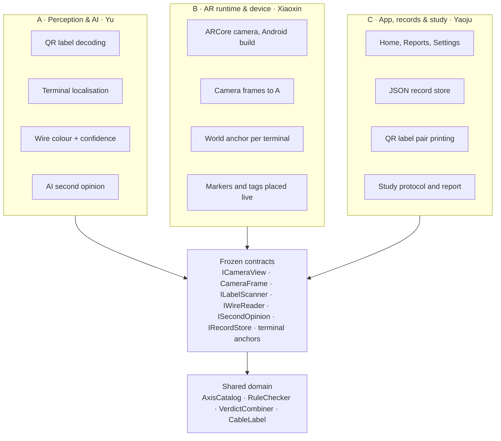
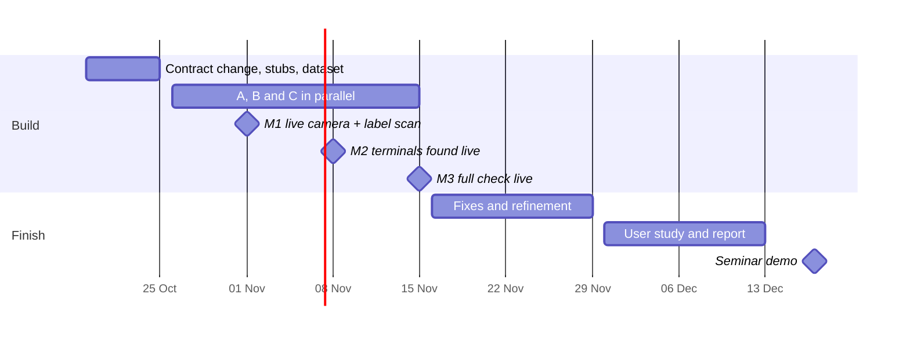

# Installer Assistant – Blueprint Freeze & Work Split

Yu · 18 Oct 2026. The team's plan: what is frozen, who builds what, how we work together, and when. Change it through a pull request like any other file.

Freeze the blueprint now: the flow, screens, wiring rules and verdict logic are settled, and the sensing services are already behind interfaces. Split the work along those interfaces into three packages: A · Perception & AI (Yu), B · AR runtime & device (Xiaoxin), C · App, records & study (Yaoju).

## Freeze verdict

Yes, freeze it, with one contract change first. The blueprint already separates what is settled (flow, screens, A1610 wiring rules, rule check, verdict table, records, log) from what is still faked (the sensing services behind interfaces). That boundary is exactly where three people can work in parallel.

| Frozen now | Still open (owned, not frozen) |
| --- | --- |
| Either-end-first flow, Home, walk, verdict, fix and report screens | Pixel polish after the user test |
| Wiring rules (`AxisCatalog`), `RuleChecker` (incl. fix where you stand), `VerdictCombiner` (amber below 0.80) | The confidence threshold value, tuned from real data |
| Label format `IA\|door\|usage\|id\|DEV/CTRL` | Physical label size and material |
| Interfaces `ICameraView`, `ILabelScanner`, `IWireReader`, `ISecondOpinion`, `IRecordStore` | How each is implemented (AR runtime, QR library, CV method, which VLM, file format) |
| Design system (`UiKit`), adaptive tag layout (`TagLayout`) | Tag behaviour under live camera motion |

**The one change before freezing (made on 18 Oct).** The terminal positions on the photo came from hand-calibrated points in `DemoLayout`. On a live camera nothing provides them, so the wire reader must return them. An image position per terminal (and the frame it refers to) is now on `DeviceEndReading` and `ControllerReading`, and a `CameraFrame` type carries the image from the AR runtime to the readers. After that change, no package needs to edit another package's code. It is in the code: `Detection/CameraFrame.cs`, `ImagePoint` positions on both readings, and frames passed to `ILabelScanner`, `IWireReader` and `ISecondOpinion`; the Wizard-of-Oz versions fill them from the bench photos.

## Three work packages

Each package owns one layer and talks to the others only through the frozen contracts, so each person can build and test alone with the Wizard-of-Oz stand-ins until integration. Getting-started pages: `docs/packages/A-perception.md`, `B-ar-runtime.md`, `C-app.md`.

| Package | Owner | Builds | Owns (code) | Done when |
| --- | --- | --- | --- | --- |
| A. Perception & AI | Yu | QR label decoding; terminal localisation on the A1610 Reader 1 block and the A4020-E terminal row; wire-colour reading with confidence; the independent AI second opinion; an offline evaluation set and harness | `Scripts/Detection`, `Scripts/AI`, `Labels/QrLabelScanner.cs`, `ml/` | On held-out bench photos of random wirings: labels decoded, terminals located and colours read with a measured accuracy and latency; the readers pass the same C# tests as the WoZ versions |
| B. AR runtime & device | Xiaoxin | Android build with AR Foundation/ARCore; the live camera view replacing the photo; hands each frame to A as a `CameraFrame`; anchors A's 2D terminal positions in the world so markers and tags stay put while the phone moves | `Scripts/AR` (`ArCameraView`; the contract `ICameraView` is shared), `Scenes/App.unity` (AR session and camera), Player and XR settings, Android builds | On the phone: live camera, markers and tags locked to the terminals while the installer moves, 30 fps, one-tap APK build |
| C. App, records & study | Yaoju | The app around the check (Home, Reports, Settings, report export); records saved to a JSON file per site; QR label pair printing; session log; user-study protocol, NASA-TLX/SUS forms, and lead on the report | `Scripts/App` (the app and `Composition`), `Scripts/Records`, `Scripts/UI`, `Scripts/WizardOfOz`, `docs/`, `Scenes/Blueprint_Demo.unity` (the Wizard-of-Oz fixture) | Records survive an app restart; labels print in DEV/CTRL pairs; the study runs end to end on the WoZ build and on the live build |

Shared and owned by all three through review: `Scripts/Verification` (wiring rules, rule check, verdict table), `Labels/CableLabel.cs` and the contract files.

## Ownership map

No package calls into another's code: they meet in the contract layer, and the Wizard-of-Oz stand-ins implement every contract until the live versions land.

## Frozen contracts

These types are the only things two packages share; changing one needs a pull request approved by all three. Everything behind them is free for its owner to change. The full list with files is in `docs/architecture.md`.

| Contract | From → to | What crosses | Note |
| --- | --- | --- | --- |
| `CameraFrame` | B → A | CPU image (RGBA32 or JPEG), width, height, intrinsics, timestamp, camera pose, id | B fills it from ARCore's CPU image; A never touches AR Foundation |
| `ICameraView` | B → app | The camera image, frames for the readers, anchors (`Anchor`, `TryGetPosition`) and end snapshots | `PhotoCameraView` in the Wizard of Oz, `ArCameraView` live; carries the terminal anchors |
| `ILabelScanner.Scan` | A → app | `LabelScan`: status, `CableLabel` (cable key + DEV/CTRL), label corners in the image | Corners let B anchor the label box |
| `IWireReader.ReadDeviceEnd / ReadControllerEnd` | A → app | `DeviceEndReading` / `ControllerReading`: colour + confidence per terminal or pin, plus image position per terminal | Position in normalised image coordinates of the frame it was read from |
| `ISecondOpinion.Compare` | A → app | `Opinion` per pin (match, mismatch, no answer) | Must not see the rule check's answer |
| Terminal anchors | B → UI | World anchor per terminal, projected to screen each frame | Replaces `DemoLayout` points; `ArOverlay` stays as it is |
| `IRecordStore` | C → app | Save and get both ends by cable key | JSON file per site |
| Perception HTTP/JSON | A (Python) ⇄ A (C#) | `/read`, `/compare`, `/health` | `ml/perception_service/schemas.py` ⇄ `Detection/PerceptionClient.cs` |
| `RuleChecker`, `VerdictCombiner`, `AxisCatalog` | shared | Pure C#, unit-tested in `tools/domain-tests` | Change only with a new test |

The Wizard-of-Oz versions stay as the fallback implementation of every contract, so the demo and the user study keep running whatever state the live parts are in.

**One app, two modes (added 18 Oct).** The product is one app in `Scripts/App`. `Composition.cs` picks the Wizard-of-Oz or the live implementation of each contract from the app's Mode, so the demo is no longer a separate program. `App.unity` starts in Wizard-of-Oz mode; Mode = Live runs a webcam (until B's AR view lands), QR decoding, the perception service in `ml/perception_service` and JSON records. Details: `docs/architecture.md`.

## Perception and AI plan (Yu)

Run perception as a small Python service on a laptop on the same Wi-Fi, with one thin C# client per contract in Unity. That keeps package A in Python and OpenCV, keeps the AI API keys off the phone, and makes the whole pipeline testable on photos without Unity. The app already waits on a progress bar, so 1–3 s per reading fits the flow.

**Pipeline per end** (one `POST /read` with the frame, the end and the usage):

1. **Label.** Decode the QR code (ISO/IEC 18004) and return its corners. In Unity this can stay on the phone with ZXing.Net, since it needs no model.
2. **Locate the terminals.** Match the frame to a reference photo of the connector (A1610 Reader 1 block, A4020-E terminal row) with ORB features (Rublee et al., 2011) and a RANSAC homography (Fischler & Bolles, 1981; Hartley & Zisserman, 2004). The known pin layout from `AxisCatalog` is then projected into the frame, giving every terminal's position. Fallback: two taps on the end pins, as the Wizard of Oz's calibration already does.
3. **Read the colours.** Crop a short strip of wire beside each terminal. Baseline: grey-world white balance (Buchsbaum, 1980), then the nearest of the 8 wire colours in CIELAB, with the margin to the second-nearest as the raw confidence. Second path: a vision-language model on the crops, not the whole frame, because these models miss fine visual detail in full scenes (Tong et al., 2024).
4. **Calibrate confidence.** Fit temperature scaling on held-out data (Guo et al., 2017) so that 0.80 means about 80 % correct. Only then does the amber threshold mean what the UI says it means.
5. **Second opinion.** A separate model call that sees both ends' crops and the pairing rule, never the rule check's answer, as layer 3 of the verdict design.

**Nothing hard-coded.** The live readers must work for any wiring an installer makes, so nothing in package A assumes a fault or a colour order. Connector layouts are templates (a reference photo with its pins marked), colour references and the temperature are fitted data files, and adding a connector or a colour means adding data, not code. The `dummy` readers are for testing the plumbing only and are never the default.

**Evaluation, built first.** A labelled set from the bench built from **random wirings**: a script (`ml/tools/random_wirings.py`) draws the wirings, mostly shuffles among the pins the rule uses and some with wires on pins that must stay empty, so the set is not biased towards the faults we expect. Each wiring is photographed under 3 lighting conditions and 2 angles; a few unclear cases (two wires in one pin, a half-inserted wire) are added on purpose to test that the reader reports low confidence. Two sessions on different days: session 1 for fitting, session 2 only for testing, so test photos are never near-duplicates of fitting ones. The harness in `ml/eval` reports:

- label decode rate
- terminal position error, and the share within half a pin pitch
- colour accuracy with a confusion matrix
- expected calibration error
- latency p50 and p95 measured from the phone

These numbers go straight into the report's results section.

## Collaboration rules

Most Unity merge pain comes from two people editing the same scene, prefab or asset; these rules make that impossible by ownership rather than by care.

- **One scene per package.** A: `Sandbox/Perception_Test.unity`, B: `App.unity` (the product scene; it gets the AR session), C: `Blueprint_Demo.unity` (the Wizard-of-Oz fixture, which must keep running after every merge). Nobody saves another package's scene; experiments go in `Sandbox/<name>*.unity`.
- **Branches.** `name/topic`, as the repo already does (e.g. `fury/wire-reader`), off `main`; a pull request into `main` for every merge, reviewed by one other member. `main` must always open in Unity without errors.
- **Code owners.** `docs/CODEOWNERS.example` maps each folder to its owner. Fill in the GitHub names and copy it to `.github/CODEOWNERS`, so GitHub asks the right person to review; the shared folders need all three.
- **Contract changes.** Proposed as a pull request that changes only the contract and its WoZ stand-in, with a one-line reason; merged when all three approve.
- **Tests on every PR.** `dotnet run --project tools/domain-tests` and `python -m pytest ml/tests` stay green; A adds a perception test that runs the C# client against saved responses.
- **No Git LFS** (the group decided against it). Keep committed photos under 1 MB each; the perception dataset lives outside the repo on the shared drive, with only a small sample set committed.
- **Docs live in the repo.** This plan, the design rationale and the guides are files in `docs/`; change them with a pull request, not in a separate shared document.
- **Weekly integration.** One fixed slot a week where `main` is built to the phone and the full flow is run once.

## Milestones

Live check end to end by 15 Nov, leaving four weeks for fixes and the study. Proposed dates to the 17 Dec seminar:

| When | What |
| --- | --- |
| 19–25 Oct | Contract change, stubs, dataset |
| 26 Oct – 15 Nov | A, B and C build in parallel |
| 1 Nov | **M1** live camera + label scan |
| 8 Nov | **M2** terminals found live |
| 15 Nov | **M3** full check live |
| 16–29 Nov | Fixes and refinement |
| 30 Nov – 13 Dec | User study and report |
| 17 Dec | Seminar demo |

Each milestone is a weekly integration run on the phone: M1 needs B's live camera and A's label scan, M2 adds A's terminal positions anchored by B, and M3 runs the whole check with C's stored records. The two weeks after M3 are fixes only, as the group planned for weeks 6–7.

## Risks and fallbacks

The largest risk is terminal localisation on a live camera; every risk below has a fallback that keeps the seminar demo and the user study running.

| Risk | Owner | Early sign | Fallback |
| --- | --- | --- | --- |
| Terminals not found reliably by feature matching (repetitive, glossy blocks) | A | Under 80 % of test photos within half a pin pitch by milestone 2 | Two-tap calibration of the end pins, then projection from the catalogue layout |
| Colour reading wrong under server-room light | A | Confusion between black/brown or yellow/orange above 10 % | Amber more often (higher threshold), installer confirms; the flow already supports it |
| AI service slow or offline | A | p95 latency above 5 s | Classical colour reading alone; second opinion switched off in Settings |
| AR anchors drift while the phone moves | B | Markers move more than one pin pitch | Freeze the frame for the result view (a still image with the overlay) |
| No power at the bench, so no LED symptom to show | C | — | Already handled: the app shows the documented symptom as text |
| Integration lands late | all | Milestone 3 slips | WoZ build stays the study build; live build shown at the seminar for the parts that work |

## References

Design rationale for the frozen blueprint: `docs/design-rationale.md`. Run and code notes: `docs/architecture.md` and `docs/blueprint-demo.md`.

- Brooke, J. (1996). SUS: A "quick and dirty" usability scale. In *Usability Evaluation in Industry* (pp. 189–194). Taylor & Francis.
- Buchsbaum, G. (1980). A spatial processor model for object colour perception. *Journal of the Franklin Institute*, 310(1), 1–26.
- Fischler, M. A., & Bolles, R. C. (1981). Random sample consensus: A paradigm for model fitting with applications to image analysis and automated cartography. *Communications of the ACM*, 24(6), 381–395. [doi:10.1145/358669.358692](https://doi.org/10.1145/358669.358692)
- Guo, C., Pleiss, G., Sun, Y., & Weinberger, K. Q. (2017). On calibration of modern neural networks. *Proc. ICML 2017*.
- Hart, S. G., & Staveland, L. E. (1988). Development of NASA-TLX (Task Load Index). *Advances in Psychology*, 52, 139–183.
- Hartley, R., & Zisserman, A. (2004). *Multiple View Geometry in Computer Vision* (2nd ed.). Cambridge University Press.
- ISO/IEC 18004:2015. Information technology – Automatic identification and data capture techniques – QR Code bar code symbology specification.
- Martin, R. C. (2017). *Clean Architecture*. Prentice Hall.
- Rublee, E., Rabaud, V., Konolige, K., & Bradski, G. (2011). ORB: An efficient alternative to SIFT or SURF. *Proc. ICCV 2011*, 2564–2571.
- Tong, S., Liu, Z., Zhai, Y., Ma, Y., LeCun, Y., & Xie, S. (2024). Eyes wide shut? Exploring the visual shortcomings of multimodal LLMs. *Proc. CVPR 2024*.
